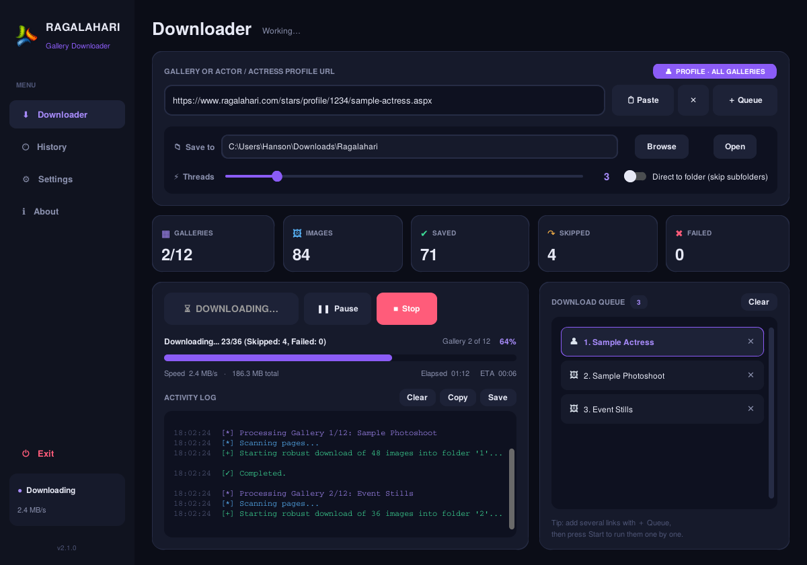
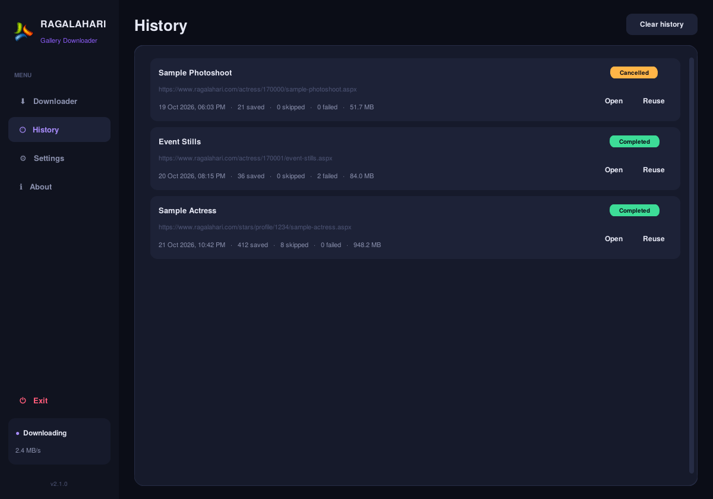
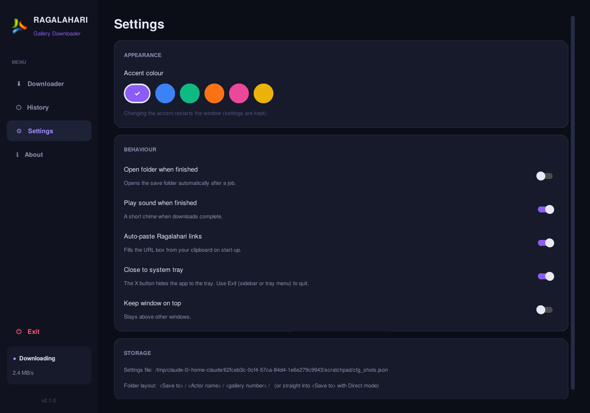

<div align="center">


# Ragalahari Gallery Downloader

**Batch-download full-resolution photo galleries from Ragalahari.com — even when the website's own images are broken.**

<p>
  <a href="https://github.com/hansonds/Ragalahari_GUI/releases/latest"></a>
  <a href="https://github.com/hansonds/Ragalahari_GUI/releases"></a>
  <a href="https://github.com/hansonds/Ragalahari_GUI/actions/workflows/build-release.yml"></a>
</p>
<p>
  
  
  
  
</p>

### [⬇️ Download the portable EXE](https://github.com/hansonds/Ragalahari_GUI/releases/latest/download/Ragalahari_Downloader.exe)

<sub>No installation · No Python needed · Just download and double-click</sub>

<br><br>



</div>

---

## 📑 Contents

- [Features](#-features)
- [Quick start](#-quick-start)
- [How to use](#-how-to-use)
- [System tray](#-system-tray)
- [Where your photos are saved](#-where-your-photos-are-saved)
- [Broken image recovery](#-feature-spotlight-broken-image-recovery)
- [Screenshots](#-screenshots)
- [Settings](#%EF%B8%8F-settings)
- [FAQ & troubleshooting](#-faq--troubleshooting)
- [Run from source / build it yourself](#-run-from-source)
- [Automatic releases](#-automatic-releases)
- [Changelog](#-changelog)
- [Disclaimer](#%EF%B8%8F-disclaimer)

---

## ✨ Features

| | |
|---|---|
| 🛟 **Broken image recovery** | Tries several Ragalahari image servers automatically, so it can still fetch HD photos that show as broken on the website. |
| 🔗 **Smart links** | Paste a single gallery **or** a whole actor / actress profile. A badge tells you instantly which one it is, and profiles download every gallery. |
| ⚡ **Fast** | Up to 15 photos at once, with large files split into 4 parts that download in parallel. |
| 📋 **Queue** | Add several links and they run one after another while you do something else. |
| ⏯️ **Pause, resume, stop** | Full control over a running job. |
| 📊 **Live dashboard** | Galleries, images, saved, skipped and failed counters, plus speed, time elapsed and time left. |
| ↻ **Retry failed** | One click re-tries only the photos that didn't download. |
| ⏭️ **Skips duplicates** | Photos you already have are skipped, so you can re-run a profile to pick up new galleries. |
| 🗂️ **History** | Every finished job is listed with counts and size, plus *Open folder* and *Reuse link* buttons. |
| 🧩 **System tray** | Close the window and it keeps downloading in the tray, then notifies you when it's done. |
| 🎨 **Themes** | Six accent colours on a dark interface that's easy on the eyes. |
| 💾 **Remembers everything** | Save folder, speed, theme, options and window size are kept between sessions. |
| 🧳 **Portable** | One `.exe`. Settings live in a small file next to it, so you can carry it on a USB drive. |

---

## 🚀 Quick start

1. **[Download `Ragalahari_Downloader.exe`](https://github.com/hansonds/Ragalahari_GUI/releases/latest/download/Ragalahari_Downloader.exe)** from the latest release.
2. Double-click it.
   > Windows may show **"Windows protected your PC"** the first time, because the app isn't code-signed. Click **More info → Run anyway**.
3. Paste a Ragalahari link, then click **▶ START DOWNLOAD**.

That's it.

---

## 📖 How to use

1. **Copy a link** from ragalahari.com. It can be either of these:
   - a **gallery** page, e.g. `https://www.ragalahari.com/actress/170000/some-photoshoot.aspx`
   - a **profile** page with all of a star's galleries, e.g. `https://www.ragalahari.com/stars/profile/1234/name.aspx`
2. Click **📋 Paste**. If **Auto-paste** is on, the link is filled in for you when the app opens. The badge on the right confirms the link type:
   - 🟣 **PROFILE · ALL GALLERIES**
   - 🔵 **SINGLE GALLERY**
   - 🔴 **NOT A RAGALAHARI LINK**
3. Pick a **Save to** folder with **Browse**.
4. Set **Threads** (speed). **3–6** is a good balance; higher is faster but puts more load on the site.
5. Optional: switch on **Direct to folder** to put every photo in one folder instead of sub-folders.
6. Press **▶ START DOWNLOAD** (or press **Enter** in the link box).

**Downloading several links:** paste a link and click **＋ Queue**, then repeat for each link. When you press Start, the whole queue runs in order. Remove an item with its **✕**.

**While it runs:** use **Pause / Resume** and **Stop**. If anything fails, a yellow **↻ Retry** button appears when the job ends.

---

## 🧩 System tray

- Clicking the window's **✕** **hides the app to the tray** (near the clock) instead of quitting, and downloads keep going.
- **Hover** over the tray icon to see progress, and **double-click** it to bring the window back.
- **Right-click** the tray icon for: **Show window · Pause / Resume · Stop · Open download folder · Exit**.
- To quit, use **Exit** in the tray menu, the red **⏻ Exit** in the sidebar, or press **Ctrl + Q**. You'll always be asked to confirm, with a warning if a download is still running.
- Don't want tray mode? Turn off **Settings → Close to system tray**, and ✕ will ask to exit instead.

> 💡 If you can't see the icon, click the small **^** arrow on the taskbar. You can drag the icon out so it's always visible.

---

## 📁 Where your photos are saved

**Default (sub-folders):**

```
Ragalahari/                     ← your "Save to" folder
└── Actor Name/
    ├── 1/                      ← gallery 1 (oldest first)
    │   ├── photo001.jpg
    │   └── ...
    ├── 2/
    └── 3/
```

Single gallery links go into `Direct/1/`.

**With "Direct to folder" on:** every photo goes straight into your **Save to** folder.

---

## 🦸 Feature spotlight: broken image recovery

Older galleries on the site often show **broken image icons** because of dead links or blocked servers. This app skips the web page's images and asks Ragalahari's backend image servers directly (`imgcdn`, `starzone`, `img`, `szcdn1`). If one server fails, it moves on to the next.

<table>
<tr>
<td align="center" width="50%"><b>The website</b><br><sub>images fail to load</sub><br><br></td>
<td align="center" width="50%"><b>The app</b><br><sub>finds a working server and downloads them anyway</sub><br><br></td>
</tr>
</table>

---

## 🖼️ Screenshots

<table>
<tr>
<td align="center"><b>History</b><br></td>
<td align="center"><b>Settings</b><br></td>
</tr>
</table>

---

## ⚙️ Settings

| Setting | What it does |
|---|---|
| **Accent colour** | Violet, Ocean, Emerald, Sunset, Rose or Gold. |
| **Open folder when finished** | Opens the save folder automatically after each job. |
| **Play sound when finished** | A short chime when downloads complete. |
| **Auto-paste Ragalahari links** | Fills the link box from your clipboard when the app opens. |
| **Close to system tray** | ✕ hides to the tray instead of quitting (on by default). |
| **Keep window on top** | Keeps the app above other windows. |

All settings are saved in `ragalahari_gui_config.json` **next to the EXE**. Delete that file to reset everything.

---

## ❓ FAQ & troubleshooting

<details>
<summary><b>Windows says "Windows protected your PC"</b></summary>

The EXE isn't code-signed (signing costs money), so SmartScreen warns about it. Click **More info → Run anyway**. The EXE is built automatically by GitHub Actions from the code in this repo, so you can check exactly what's in it.
</details>

<details>
<summary><b>My antivirus flagged the EXE</b></summary>

Apps packed with PyInstaller sometimes trigger false positives. You can check the file on [VirusTotal](https://www.virustotal.com/), or run the app from source (see below).
</details>

<details>
<summary><b>"No galleries found" or "No images found"</b></summary>

Make sure the link is a **gallery** or **profile** page that ends in `.aspx`, then open it in your browser to check it loads. The site may be temporarily down, or blocked on your network; try again later or use a VPN.
</details>

<details>
<summary><b>Some images failed</b></summary>

Click **↻ Retry** after the job ends. Lowering **Threads** often helps on slow or unstable connections. Images that are truly gone from every server can't be recovered.
</details>

<details>
<summary><b>I closed the window — is it still running?</b></summary>

Yes, it's in the system tray. Double-click the tray icon to show it, or right-click → **Exit** to quit.
</details>

<details>
<summary><b>Can I stop and continue later?</b></summary>

Yes. Run the same link again and photos you already have are skipped automatically.
</details>

---

## 🛠️ Run from source

Requires **Python 3.8+** on Windows.

```bash
git clone https://github.com/hansonds/Ragalahari_GUI.git
cd Ragalahari_GUI
pip install -r requirements.txt
python ragalahari_gui.py
```

### Build the EXE yourself

```bash
pip install pyinstaller
pyinstaller ragalahari_gui.py --name Ragalahari_Downloader --onefile --windowed ^
  --icon logo.ico --add-data "logo.ico;." --add-data "logo.png;." ^
  --collect-data customtkinter --hidden-import pystray._win32
```

The EXE appears in the `dist/` folder.

---

## 🤖 Automatic releases

You never have to build the EXE by hand. The [**Build portable EXE & publish release**](.github/workflows/build-release.yml) workflow:

1. Runs automatically whenever `ragalahari_gui.py` (or the icons / requirements) changes on `main`. You can also start it from the **Actions** tab → **Run workflow**.
2. Builds `Ragalahari_Downloader.exe` on a Windows machine.
3. Publishes it to [**Releases**](https://github.com/hansonds/Ragalahari_GUI/releases), tagged with the version from `APP_VERSION` in the script.

**To release a new version:** change `APP_VERSION = "2.1.0"` near the top of `ragalahari_gui.py` (for example to `"2.2.0"`) and push. If you push without changing the number, the existing release's EXE is replaced with the new build.

---

## 📝 Changelog

**v2.1.0**
- System tray mode: ✕ hides to the tray, with a tray menu (Show · Pause/Resume · Stop · Open folder · Exit)
- Exit with confirmation from the tray, the sidebar or Ctrl+Q
- Tray notifications when a background download finishes

**v2.0.0**
- Completely redesigned dashboard interface with sidebar navigation
- Live stats, speed, ETA and elapsed time
- Download queue, pause / resume, retry failed
- History page, settings page, six accent themes
- Colour-coded activity log with copy / save
- Automatic EXE builds and releases via GitHub Actions

**v1.0**
- First release: multi-threaded downloads, CDN recovery, profile and gallery support

---

## 🤝 Contributing

Issues and pull requests are welcome.

1. Fork the repo
2. Create a branch: `git checkout -b feature/my-idea`
3. Commit: `git commit -m "Add my idea"`
4. Push: `git push origin feature/my-idea`
5. Open a Pull Request

---

## ⚠️ Disclaimer

> This tool is for **educational and personal archiving purposes only**. Please respect the Terms of Service of [Ragalahari.com](https://www.ragalahari.com) and keep thread counts reasonable so you don't overload their servers. All images belong to their respective owners. The developer accepts no liability for misuse of this software or for copyright infringement.

## ⚖️ License

Distributed under the **MIT License**. See [`LICENSE`](LICENSE) for details.

<div align="center">
<br>
<sub>Made with ❤️ by <a href="https://github.com/hansonds">hansonds</a> · If this helped you, give the repo a ⭐</sub>
</div>
